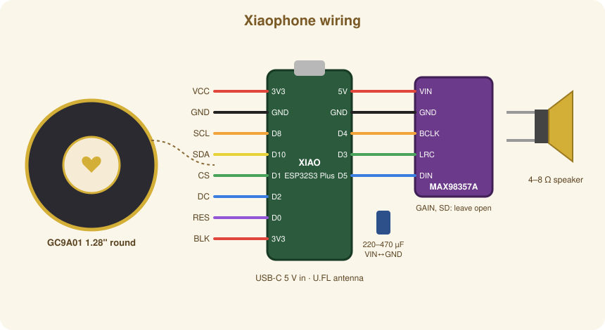

# Xiaophone

A tiny ivory + gold gramophone whose "record" is a 1.28" round display showing the
album cover of the song playing — cropped into a circle and spinning like vinyl.
One Seeed XIAO ESP32S3 Plus streams Wi-Fi internet radio, looks up the cover, and spins it.
It is also a Spotify Connect speaker: pick "Xiaophone" in the Spotify app and the record
shows that song's cover.

## Parts

- Seeed XIAO ESP32S3 Plus (16 MB flash, 8 MB PSRAM) + its U.FL Wi-Fi antenna
- 1.28" 240×240 round IPS display, GC9A01 driver (SPI)
- MAX98357A I2S amplifier breakout
- Small 4–8 Ω speaker (about 2–3 W, 28–40 mm)
- 220–470 µF electrolytic capacitor
- USB-C cable and 5 V supply
- 3D-printed enclosure (ivory + gold PLA)

## Wiring (XIAO ESP32S3 Plus)

| Part | Pin | XIAO pin (GPIO) |
|---|---|---|
| GC9A01 display | VCC | 3V3 (never 5V) |
| | GND | GND |
| | SCL (SCK) | D8 (GPIO7) |
| | SDA (MOSI) | D10 (GPIO9) |
| | CS | D1 (GPIO2) |
| | DC | D2 (GPIO3) |
| | RES | D0 (GPIO1) |
| | BLK | 3V3 |
| MAX98357A | VIN | 5V |
| | GND | GND |
| | BCLK | D4 (GPIO5) |
| | LRC | D3 (GPIO4) |
| | DIN | D5 (GPIO6) |
| | GAIN, SD | unconnected |
| Speaker | + / − | MAX98357 outputs |

Add a 220–470 µF cap across the MAX98357 VIN/GND.

## Build

Firmware (VS Code + PlatformIO, ESP-IDF + Arduino build):
1. Clone with the submodule: `git clone --recursive …` (or `git submodule update --init`).
2. Run `pio run` once (it sets up ESP-IDF and its Python env, then stops at the Spotify
   protobuf step). The Spotify library generates code from protobuf files, so that Python needs:
   `~/.platformio/penv/.espidf-5.5.0/Scripts/pip install protobuf grpcio-tools "setuptools<81"`
   (on macOS/Linux use `bin/pip` instead of `Scripts/pip`).
3. Copy `firmware/src/secrets.example.h` to `firmware/src/secrets.h` and fill in Wi-Fi and stations.
4. Upload the sounds to flash (once, and whenever `firmware/data/` changes):
   `pio run -t uploadfs`
5. Upload the firmware and open the monitor: `pio run -t upload -t monitor` (115200 baud).
6. Screw on the Wi-Fi antenna before powering up.

The two sound files in `firmware/data/` are generated by `python firmware/tools/gen_sounds.py`
(standard library only). For a no-radio demo, set `DEMO_MODE 1` in `firmware/src/config.h`.
It then shows five well-known covers in turn, one every 20 s.

### Spotify

Needs Spotify Premium. Put the phone on the same Wi-Fi as the Xiaophone, start a song,
tap the devices icon and pick **Xiaophone**. The radio pauses, the speaker plays Spotify,
and the record shows the album cover sent by Spotify. Volume follows the phone. After
the first login the device remembers it (in NVS) and reconnects on its own after a reboot.
Pause for 5 minutes or disconnect in the app and the radio comes back.

Spotify support uses [cspot](https://github.com/feelfreelinux/cspot), an unofficial Spotify
Connect client, via [spotifyesp](https://github.com/sharkzor/spotifyesp). It is not made or
endorsed by Spotify and may stop working if Spotify changes its protocol.

Known issue (2026): for many accounts, especially newer ones, Spotify refuses the track
key that unofficial clients use (`Audio key refused by Spotify ... code 0001`). The device
connects and the app shows it playing, but no audio arrives. This happens on Spotify's side
and also affects librespot and go-librespot. There is no fix yet. An older account may work.

Serial logs are tagged `[WIFI] [AUDIO] [META] [COVER] [GFX] [MEM] [SPOTIFY]`. FPS, heap and PSRAM
are printed every 5 s.

## How the cover lookup works

1. The station sends the song as ICY metadata, e.g. `Daft Punk - Get Lucky`. Junk is
   stripped (`(Remastered)`, `[Live]`, `feat. …`) and the text is split into artist and title.
2. MusicBrainz is searched for recordings by that artist whose title matches. Every
   release containing one is scored: album/single/EP +2, not a compilation, live or
   remix +4, official release +1. Ties go to the earliest date, so the original album
   usually beats a later reissue.
3. The top 8 release-groups are tried on the Cover Art Archive until one has a front
   cover. Its 250 px thumbnail is downloaded, decoded, centre-cropped to a 240 px
   circle and given vinyl grooves.
4. The last 20 results, misses included, are cached in PSRAM. Requests time out after 5 s
   and MusicBrainz gets at most one request per second. With no cover found, the
   default cream label with a pulsing gold heart spins instead.

HTTPS requests skip certificate checks (`setInsecure`). The lookup only reads public
data, so no secrets are ever sent.

## Enclosure

The cabinet was designed in Blender. Print-ready files are in `enclosure/stl/`: one STL
per part, already oriented for the bed, plus `xiaophone_all.3mf`.

| Part | Colour | Notes |
|---|---|---|
| shell | matte ivory | prints upside down, display pocket on the bed |
| plate | matte ivory | feet down, supports under the speaker pod |
| horn | silk gold | mouth down, tree supports under the neck |
| rim, tonearm, pivot_knob, crank, caps, trims, grille, heart | silk gold | small parts pin on with 1.75 mm filament snips |
| vinyl | matte black | grooves on the bed |

`stl/test_display_pocket.stl` is the top 6 mm of the shell: print it first to check the
display fit.

## Credits

Song data from [MusicBrainz](https://musicbrainz.org) (CC0); cover images from the
[Cover Art Archive](https://coverartarchive.org). Built with
[ESP32-audioI2S](https://github.com/schreibfaul1/ESP32-audioI2S),
[LovyanGFX](https://github.com/lovyan03/LovyanGFX),
[JPEGDEC](https://github.com/bitbank2/JPEGDEC) and
[ArduinoJson](https://arduinojson.org). All sounds and graphics are original and generated in code.

## License

MIT for the code in this repository. The Spotify part links cspot, which is GPL-3.0, so a
firmware binary built from this branch is covered by the GPL-3.0 as a whole.
